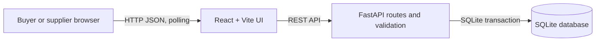

# British Auction RFQ

A local RFQ demo for supplier price bidding. Buyers create an auction with configurable extension rules; suppliers submit and improve quotes; the API ranks bids and records close-time extensions.

## Features

- Create RFQs with a scheduled start, bid close, forced close, service date, and extension settings.
- Accept one current bid per supplier. A supplier can replace it only with a lower total.
- Rank quotes by total freight, origin, and destination charges.
- Extend the close when a selected trigger occurs within the configured window. The forced close is a hard cap.
- Record bid and extension events in an activity log.
- Refresh auction details in the browser every five seconds using HTTP polling.

The demo has no authentication and does not use WebSockets. Supplier names are entered as form text; this is suitable for local evaluation, not production use.

## Architecture



The backend owns auction state. Bid acceptance, rank comparison, extension calculation, and activity logging run in a SQLite transaction. The extension is capped at the forced close. See [docs/architecture.md](docs/architecture.md) for request flow and limitations.

## Technology

- Python 3.10+, FastAPI, Pydantic, SQLite
- React 19, TypeScript, Vite, lucide-react
- `unittest` for backend behavior checks
- Ruff linting and formatting checks for Python
- TypeScript strict type checking
- Prettier formatting checks for frontend files
- GitHub Actions for backend tests and frontend formatting, type checking, and production builds

## Project layout

```text
backend/
  app/main.py          API routes, validation, and auction logic
  tests/               Backend behavior tests
  requirements.txt     Pinned Python runtime dependencies
  requirements-dev.txt Runtime and Ruff development dependencies
  pyproject.toml       Ruff lint and format settings
frontend/
  src/App.tsx          Auction listing, details, and bid forms
  src/style.css        Application styles
  package.json         Frontend scripts and dependencies
docs/                  Architecture notes
.github/workflows/     Continuous integration
```

## Prerequisites

- Python 3.10 or newer
- Node.js 20.19+ or 22.12+ and npm

## Run locally

In PowerShell, start the backend in one terminal:

```powershell
cd backend
py -3 -m venv .venv
.\.venv\Scripts\Activate.ps1
python -m pip install -r requirements-dev.txt
uvicorn app.main:app --reload
```

Start the frontend in a second terminal from the repository root:

```powershell
cd frontend
Copy-Item .env.example .env.local
npm ci
npm run typecheck
npm run dev
```

Open the Vite URL shown in the terminal, normally http://localhost:5173. FastAPI's interactive API docs are at http://localhost:8000/docs. The SQLite database is created automatically at `backend/auction.db` and is excluded from Git.

### Configuration

The backend reads `AUCTION_DB` to override the default SQLite path. The frontend reads `VITE_API_BASE_URL`; `.env.example` points it at `http://localhost:8000`. Vite exposes `VITE_` variables to browser code, so do not put secrets in them.

## API overview

| Method | Path | Purpose |
|---|---|---|
| `GET` | `/api/health` | Health response |
| `GET` | `/api/auctions` | List auctions with current lowest bid and status |
| `POST` | `/api/auctions` | Create an auction |
| `GET` | `/api/auctions/{id}` | Get auction, ranked bids, and activity |
| `POST` | `/api/auctions/{id}/bids` | Submit or improve a supplier quote |

Example auction request (all timestamps must include a timezone):

```json
{
  "name": "Singapore to Rotterdam",
  "reference_id": "RFQ-2026-014",
  "starts_at": "2026-11-13T09:00:00Z",
  "closes_at": "2026-11-13T10:00:00Z",
  "forced_closes_at": "2026-11-13T10:30:00Z",
  "service_date": "2026-12-01",
  "trigger_minutes": 10,
  "extension_minutes": 5,
  "triggers": ["bid_received", "any_rank_change", "l1_change"]
}
```

Example bid request:

```json
{
  "supplier": "Example Carrier",
  "freight": 1200.00,
  "origin": 85.00,
  "destination": 140.00,
  "transit_days": 21,
  "valid_until": "2026-12-15"
}
```

## Data model

SQLite has three tables:

- `auctions`: RFQ schedule, service date, trigger configuration, effective close, and creation time.
- `bids`: current quote per supplier and auction, including charge breakdown, total, transit days, and validity date.
- `activity`: bid and extension event kind, message, and timestamp.

Tables and indexes are initialized at application startup with `CREATE TABLE/INDEX IF NOT EXISTS`. There is no migration framework; changing an existing schema requires a deliberate migration. Monetary values currently use SQLite `REAL`, which is convenient for this demo but can introduce rounding error. A production system should use integer minor units or a fixed-precision decimal representation.

## Checks

From the repository root:

```powershell
cd backend
python -m unittest discover -s tests -v
python -m ruff check app tests
python -m ruff format --check app tests
cd ..\frontend
npm ci
npm run format:check
npm run typecheck
npm run build
```

The same Python lint/format checks, backend tests, frontend format/type checks, and build run in GitHub Actions.

## Known limitations and next steps

- There is no authentication, supplier identity verification, or authorization.
- The UI polls every five seconds; it does not push updates over WebSockets.
- Supplier names are self-reported and visible in the auction details.
- SQLite and floating-point money are intended for a small demo, not concurrent production bidding.
- Add authentication, a production database and migrations, decimal-safe amounts, and WebSockets only if the project scope grows beyond the assignment.

## Contributing

See [CONTRIBUTING.md](CONTRIBUTING.md) for local checks and contribution expectations.

## License

No license is currently provided. The repository is public, but reuse and redistribution permissions have not been granted by a license. Choose a license only after the owner confirms the intended terms.
