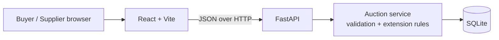

# British Auction RFQ

A small RFQ and British auction demo built with FastAPI, SQLite, and React.

## Run locally

Backend (Python 3.10+):

```powershell
cd backend
python -m venv .venv
.venv\Scripts\Activate.ps1
pip install -r requirements.txt
uvicorn app.main:app --reload
```

Frontend (Node.js):

```powershell
cd frontend
npm install
npm run dev
```

The UI runs at http://localhost:5173 and API documentation at http://localhost:8000/docs. SQLite data is stored in `backend/auction.db`.

## HLD



The API is the source of truth for auction state. Bid submission and extension happen in one SQLite transaction. Every accepted bid and extension is recorded in the activity log. The effective close can only move forward and is capped at the forced close. This demo uses polling from the UI rather than WebSockets.

## Data model

- `auctions`: RFQ details, start/close/forced-close times, trigger window, extension duration, enabled triggers, current effective close, and creation time.
- `bids`: auction, supplier, quote charges, transit time, validity, total, submission time. A supplier has one current bid per auction; a later accepted bid replaces that supplier's quote.
- `activity`: auction, event kind, event time, optional bid reference, and human-readable extension reason.

Amounts are decimal values represented as SQLite `REAL` for this assignment demo. For production, use a fixed-precision decimal type and database migrations.
